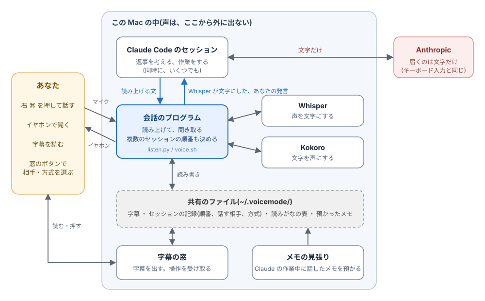

# 10-voice

Claude Code と音声で会話しながら作業するためのスキル。音声認識と読み上げは Mac 上で動作し、音声は外部に送信されない。



## 特長

| | |
|---|---|
| **音声は外部に送信されない** | 音声認識と読み上げは、すべて Mac 上で処理する。Anthropic に送られるのは、キーボード入力と同じテキストだけ |
| **誤作動しにくい** | マイクが有効になるのは、右 ⌘ キーを押している間だけ。咳や物音で読み上げが止まったり、誤って聞き取られたりしない |
| **字幕を表示する** | 読み上げた内容と、認識された発言を、画面上のウィンドウに表示する。聞き直し、読み上げ速度の変更、一時停止も、ここで操作できる |
| **複数のプロジェクトで同時に使える** | 話すのは一度に 1 つ。自動で順番に話し、話す相手はタブで選べる |
| **音声でメモを取れる** | 思いついた「あとでやること」を、会話を中断せずに記録できる。Claude の作業中でも記録できる |

機能の一覧は、[使い方](docs/使い方.md) を参照。

## 動作環境

- Apple シリコン搭載の Mac(macOS 26.6.2 で確認)、Claude Code(2.1.327 で確認)
- Homebrew、`uv`、Xcode のコマンドラインツール
- マイク付きのイヤホン
- ディスクの空き容量 5GB 以上、メモリの空き 3GB 程度
- 日本語での会話を前提にしている

## インストール

詳しい手順は、[セットアップ手順](docs/セットアップ手順.md) を参照。大まかな流れは次のとおり。

1. VoiceMode 9.0.2 と、Mac 上で動く Whisper(音声認識)、Kokoro(読み上げ)をインストールする
2. 接続先と待ち受けを、ローカル(`127.0.0.1`)だけに制限する
3. このリポジトリを clone し、スキルのフォルダへシンボリックリンクを張る

```
ln -s <このリポジトリの場所>/skills/10-voice ~/.claude/skills/10-voice
```

## 使い方

Claude Code で `/10-voice` と入力すると、音声での会話が始まる。

| 場面 | 操作 |
|---|---|
| 話す | 右 ⌘ キーを押し、合図音が鳴ってから話す |
| 話し終える | キーを離す |
| 読み上げを止める | 読み上げ中に、キーを長めに押す |
| あとでやることをメモする | キーを押し、合図音のあとに「メモ、(内容)」と言う |
| 会話を終える | 「終わり」と言う |

キーを使わない方式、字幕ウィンドウの操作、読み方の登録などは、[使い方](docs/使い方.md) を参照。

## ドキュメント

| ドキュメント | 内容 |
|---|---|
| [使い方](docs/使い方.md) | すべての機能と操作、注意点 |
| [セットアップ手順](docs/セットアップ手順.md) | インストール、トラブルシューティング、アンインストール |
| [仕組み](docs/仕組み.md) | 動作の仕組みの図、プログラムの構成、設計の考え方 |

## ライセンス

[MIT](LICENSE)
