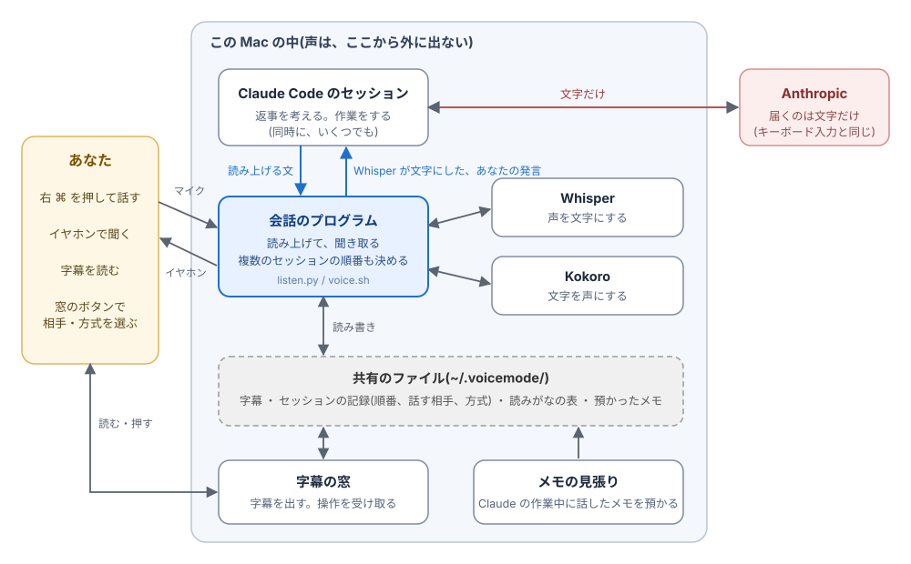
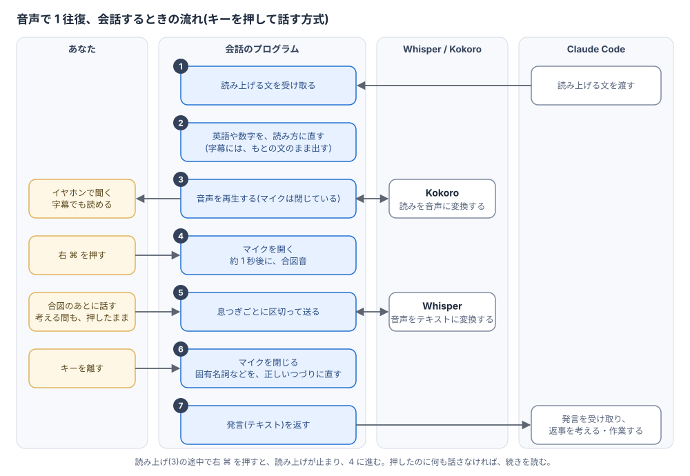
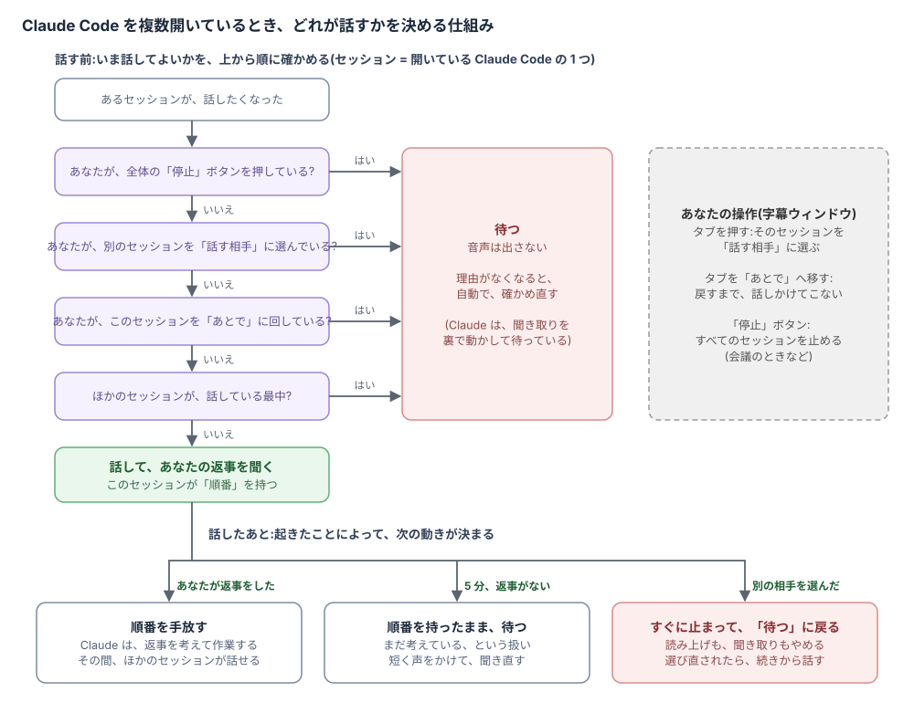
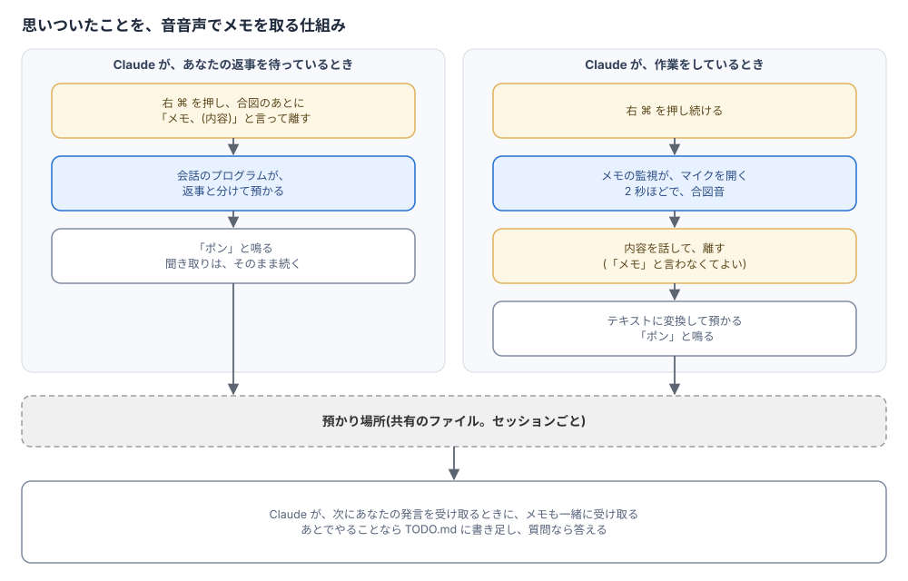
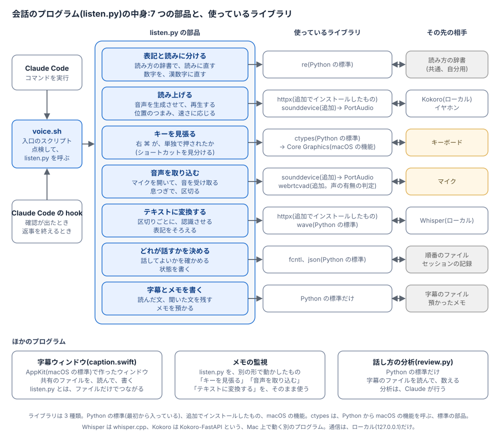
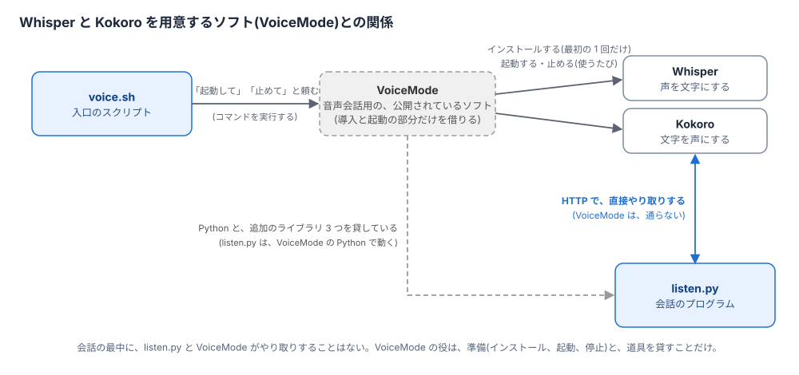

# 仕組み

このスキルが、どう動いているかを、図で説明する。1〜6 は使う人向け、7 と 8 は、中身を直したい人向け。

図の中の「あなた」は、このスキルを使う人のこと。「セッション」は、開いている Claude Code の 1 つ(プロジェクトごとに 1 つ)のこと。

## 1. 全体の構成

あなた、Claude Code、音声のプログラムが、どうつながっているか。声は Mac の外に出ず、Anthropic に届くのは文字だけ。

## 2. 声で 1 往復、会話するときの流れ

Claude が話してから、あなたの返事が Claude に届くまでを、順に追ったもの。キーを押して話す方式の場合。

「以上」と言うまで聞く方式では、4 と 6 が変わる。マイクは、読み上げの前から開いていて、「以上」と言うと閉じる。

## 3. Claude Code を複数開いているとき、どれが話すかを決める仕組み

複数のプロジェクトで同時に使っても、声が重ならないようにする決まり。話すのは、一度に 1 つだけ。

## 4. 思いついたことを、声でメモする仕組み

会話の途中や、Claude の作業中に、あとでやることを声で残せる。メモは、そのプロジェクトの `TODO.md` に入る。

## 5. Claude Code が、実行の確認を出して止まったときに、声で知らせる仕組み

声で会話していると、画面を見ていないので、確認に気づけない。それを声で知らせる。[セットアップ手順](セットアップ手順.md)の手順 7 を設定した場合に働く。

## 6. 英語の言葉や数字を、正しく読み上げて、正しく聞き取る仕組み

日本語の音声は、英語や数字が苦手。読み方の表を使って、読み上げと聞き取りの両方を助ける。

## 7. 会話のプログラム(listen.py)の中身

プログラムの 7 つの部品と、それぞれが使っているライブラリ、その先の相手。

## 8. Whisper と Kokoro を用意するソフト(VoiceMode)との関係

音声認識(Whisper)と読み上げ(Kokoro)は、[VoiceMode](https://github.com/mbailey/voicemode) という公開ソフトの機能でインストールし、起動している。会話そのものには、VoiceMode を使っていない。

