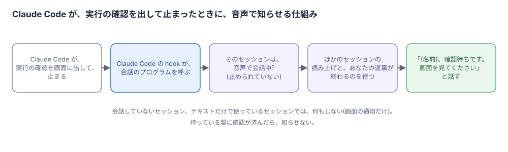
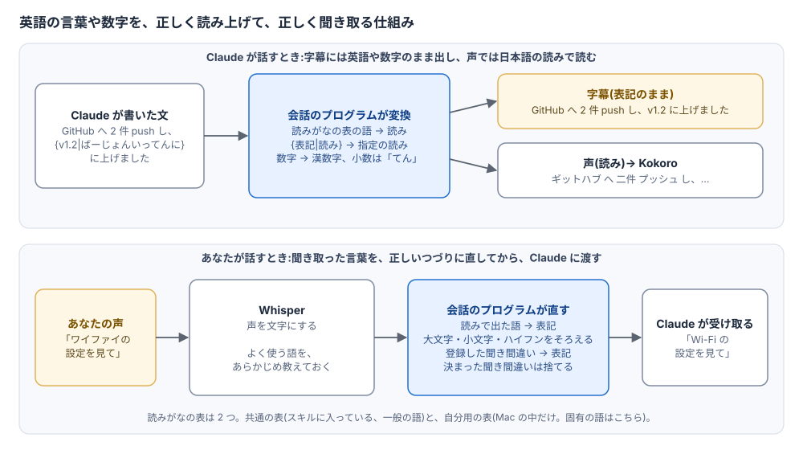

# 仕組み

このスキルが、どう動いているかを、図で説明する。1〜6 は使う人向け、7 から後ろは、中身を直したい人向け。

図の中の「あなた」は、このスキルを使う人のこと。「セッション」は、開いている Claude Code の 1 つ(プロジェクトごとに 1 つ)のこと。

## 1. 全体の構成

あなた、Claude Code、音声のプログラムが、どうつながっているか。音声は外部に送信されず、Anthropic に送られるのはテキストだけ。

## 2. 音声で 1 往復、会話するときの流れ

Claude が話してから、あなたの返事が Claude に渡されるまでを、順に追ったもの。キーを押して話す方式の場合。

「以上」と言うまで聞く方式では、4 と 6 が変わる。マイクは、読み上げの前から開いていて、「以上」と言うと閉じる。

## 3. Claude Code を複数開いているとき、どれが話すかを決める仕組み

複数のプロジェクトで同時に使っても、声が重ならないようにする決まり。話すのは、一度に 1 つだけ。

## 4. 思いついたことを、音音声でメモを取る仕組み

会話の途中や、Claude の作業中に、あとでやることを声で残せる。メモは、そのプロジェクトの `TODO.md` に入る。

## 5. Claude Code が、実行の確認を出して止まったときに、音声で知らせる仕組み

音声で会話していると、画面を見ていないので、確認に気づけない。それを音声で知らせる。[セットアップ手順](セットアップ手順.md)の手順 7 を設定した場合に働く。

## 6. 英語の言葉や数字を、正しく読み上げて、正しく聞き取る仕組み

日本語の音声は、英語や数字が苦手。読み方の辞書を使って、読み上げと聞き取りの両方を助ける。

## 7. 会話のプログラム(listen.py)の中身

プログラムの 7 つの部品と、それぞれが使っているライブラリ、その先の相手。

## 8. Whisper と Kokoro を用意するソフト(VoiceMode)との関係

音声認識(Whisper)と読み上げ(Kokoro)は、[VoiceMode](https://github.com/mbailey/voicemode) という公開ソフトの機能でインストールし、起動している。会話そのものには、VoiceMode を使っていない。

## 9. 役割と、使っているもの

| 役割 | 使っているもの |
|---|---|
| 音声認識 | Whisper(whisper.cpp、モデルは large-v3-turbo)。`127.0.0.1:2022` で動く |
| 読み上げ | Kokoro(声は `jf_alpha`)。`127.0.0.1:8880` で動く |
| サービスの導入と管理 | [VoiceMode](https://github.com/mbailey/voicemode) 9.0.2 |
| 会話の進行 | `skills/10-voice/scripts/listen.py`(読み上げ、聞き取り、割り込み、順番待ち) |
| サービスの起動と停止、外部送信の点検 | `skills/10-voice/scripts/voice.sh` |
| 話し方の分析 | `skills/10-voice/scripts/review.py` が発言と数を取り出し、Claude が `skills/10-voice/review.md` の手順で分析する |
| 読み方の辞書 | `skills/10-voice/scripts/yomi.tsv`。自分用の読みは `~/.voicemode/10-voice-yomi.tsv` に足す |
| 字幕ウィンドウ | `skills/10-voice/scripts/caption.swift`(初回に自動でビルドされる) |
| 音声メモ | `listen.py` が預かる。Claude の作業中は、見張り(`listen.py --memo-watch`。`voice.sh on` が起動する)が、キーが押されている間だけマイクを開く |
| 確認待ちの知らせ | Claude Code の hook(`Notification`)から `voice.sh notify` を呼ぶ |
| 会話が止まらないようにする | Claude Code の hook(`Stop`)から `voice.sh stop-check` を呼ぶ。聞き取りを呼ばずに返事を終えようとしたら、1 回だけ引き止める |

## 10. 設計の考え方

- **話し終わりを、キーを離すこと、または合言葉で判定する。** 無音の長さで判定すると、考えている途中で切れる。内容や抑揚から判定するモデルは、一定の割合で誤る
- **既定は、キーを押している間だけ聞く方式にする。** 声で割り込める方式は、くしゃみや物音でも読み上げが止まり、無音や雑音が、言葉として認識されることがある
- **マイクは、キーを押している間だけ開く。** マイクが開いている時間を短くするため。Bluetooth のイヤホンは、マイクを開いた直後の約 1 秒は音を拾えないので、開いてから合図を鳴らし、そのあとの声を聞き取る。「以上」で終える方式では、割り込みを聞き取るために、読み上げの前から話し終わるまでマイクを開く
- **方式は、全セッションで 1 つにする。** セッションごとに方式が違うと、いま話しているセッションがどちらの方式かを、覚えていないといけなくなる
- **送信先を固定する。** スクリプトの送信先は `127.0.0.1` の Whisper と Kokoro だけで、引数や設定では変えられない。音声はメモリ上だけで扱い、ファイルに保存しない
- **字幕は Mac 上だけに置く。** 読み上げた文と聞き取った文を、本人だけが読めるフォルダ(`~/.voicemode/10-voice-captions/`)に、日付ごとのファイルで残す。字幕ウィンドウがそれを表示する。自動では消えないので、不要になったら手で消す
- **起動のたびに点検する。** `voice.sh on` は、接続先が ローカルだけか、OpenAI の API キーがないか、待ち受けが `127.0.0.1` だけかを確かめ、満たさなければ起動しない
